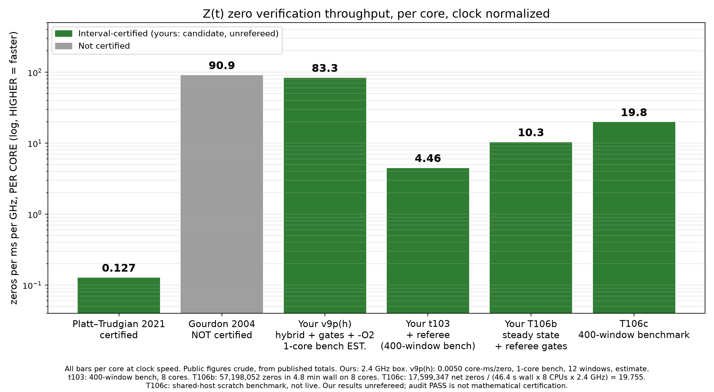

# Certified zeta evaluator and contiguous verification database

**Nathan A. Meeks & Grok — [NUM]/[LEM] candidate, unrefereed. This does not prove RH.**
Internal numerical Audit reports are included for transparency; they are **not external peer review or mathematical certification**.

## Contents and provenance

- `proof-runtime/v9p/fftzi_v9.c`: exact v9p core used for the v9p(h) hybrid/gate lineage; C0 removable-singularity and Riemann–Siegel N-step fixes included. The `(h)` label denotes the hybrid search/gate configuration, not a separate C source. Core SHA256: `87c2ce27db4bb71b52074b3aebf0f69e0a56d785fb009abfd4a919fac8845bea` (byte-identical in the live, speed2/v9p and hybrid/v9p copies).
- `proof-runtime/gates.py`, `spotcheck/indgates.py`, `grs-src/`, G-Turing-P and Platt wrapper sources: referee/repair implementation snapshot. See [referee instructions](docs/REFEREE.md); do not run the historical production driver against a live database.
- [Build and tests](docs/BUILD.md), [data download and verification](docs/DATABASE.md), [publication limitations](docs/LIMITATIONS.md).
- Older evaluator sources and prior documentation are preserved separately; the current entry point is `proof-runtime/v9p/fftzi_v9.c`, not the older `c/interp/fftzi_v9.c`.

## Committed database boundary

The inspected checkpoint and contiguous `PROVEN` ledger agree on **165,468 windows, indices 0–165467**, covering **t = 3,000,000,000,000 through 3,001,701,754,120**. Endpoint counts: N(start)=12,362,403,019,661; N(end)=12,369,686,529,136; net **7,283,509,475 zeros**, subtracting overlaps (never the sum of per-window counts).

This is the project's candidate numerical verification record, conditional on its stated lemmas, implementation/library correctness, and the cited verification below 3e12. Preparation validated the committed ledger/count chain and artifact inventory; it did not independently rerun all seven billion endpoint proofs. The halted/uncommitted **window 165468 is excluded**, even though a later independent gate result exists for it. Nine non-PROVEN attempt rows are not part of the committed database.

The complete compressed bracket files, normalized committed ledger, checkpoint and selected proof journals are prepared as bulk release assets, **not merely a count or summary**. See `data/BOUNDARY.json` and the download instructions. Complete data: [candidate database release](https://github.com/NathanAMeeks/certified-zeta-evaluator/releases/tag/candidate-db-w165467-20261107). Download all chunks and SHA256SUMS; the automatic source ZIP is not the database.

## Supplied benchmark chart (unchanged original)

Exact supplied PNG SHA256: `7499d1f43f09520e5ffb479bead4e283c62c81d6717825514a6440b9476895a3`.

These are heterogeneous benchmark estimates, not controlled head-to-head comparisons. Public Platt/Gourdon figures are crude normalizations from published totals and have not been reproduced here. v9p(h)'s **83.3** is an idle-box, 12-window single-core estimate (0.0050 core-ms/zero at 2.4 GHz), not end-to-end database/referee throughput: it excludes hard repair cases, independent gates and ledger overhead. Internal Audit observed 48–59 units under shared load and one failed first attempt in 40 windows. T106c **19.8** is a shared-host scratch benchmark, **not live**: 17,599,347 net zeros / (46,400 ms × 8 allocated CPUs × 2.4 GHz) = 19.755. Do not use the overlapping sum or CPU-time-normalized ~27. Historic HYB_VC=1 timing results do not authorize sharing G-Turing and G-RS referee values; keep **HYB_VC=0 and PC_FAST=0** for referee handoffs.

Credit Nathan A. Meeks for the midpoint sign-flip probe, v8 cache, v9, Dedekind-cut enclosure, center-outward close-pair search, and ledger-driven lemma extension. Third-party FLINT/Arb, GMP, MPFR and other dependencies retain their own licensing and attribution; no third-party binaries are bundled.
